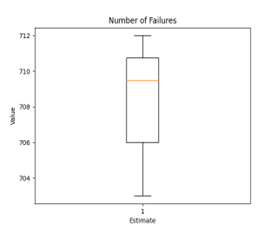
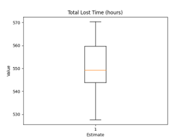
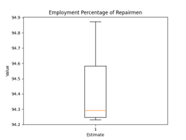
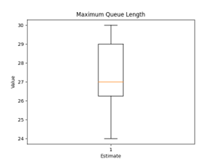
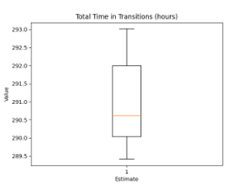
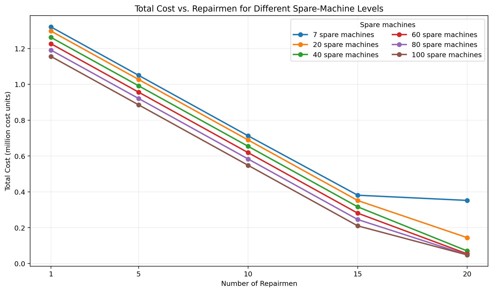

# Repairman–Spare Machine System

A discrete-event simulation study of a machine-repair system with limited repair capacity and a pool of spare machines. The project evaluates machine failures, spare-machine availability, repair queues, repairman utilization, lost production time, and the cost trade-off involved in choosing repair and spare-machine capacity.

## Project Overview

The model represents a system in which operating machines fail over time. When a machine fails, a spare machine can be used if one is available; otherwise, the failed machine remains unavailable until repair capacity and a spare machine become available. Repair work is handled by a configurable number of repairmen, and machines arriving for service may wait in a queue.

The repository contains three Python scripts:

- **Simulation** — evaluates system performance for different numbers of repairmen.
- **Statistical analysis** — estimates key performance measures across repeated simulation runs and calculates 95% Student's *t* confidence intervals.
- **Resource optimization** — compares repairman/spare-machine combinations using a cost function and identifies the lowest-cost combination in the explored search range.

## Model Configuration

The scripts use the following principal settings:

| Parameter | Value / range |
|---|---|
| Operating machines | 63 |
| Initial spare machines | 7 |
| Simulation horizon | 40 hours (2,400 model-time units) |
| Replications | 10 per configuration |
| Repairmen in the statistical-analysis script | 14 |
| Repairmen explored in the simulation and optimization scripts | 1–20 |
| Spare machines explored in the optimization script | 7–100 |

### Event-time assumptions

The model uses the following time ranges in its event logic:

| Event | Time range |
|---|---:|
| Time to a machine failure | 100–200 |
| Repair duration | 30–60 |
| Transition / handling time | 10–15 |

The scripts model the system with a **future-event list**. Each event is processed in chronological order, and system state is updated when a machine fails, a repair/transition finishes, or a machine reaches the repair facility. If every repairman is busy, an arriving machine joins the queue.

> These are the parameter values encoded in the current scripts. The time ranges are model-time units; the analysis script converts accumulated lost and transition time to hours by dividing by 60.

## Performance Measures

The statistical-analysis script reports:

- Number of machine failures
- Number of machines unavailable because no spare is available
- Total lost machine time
- Total transition time
- Maximum queue length
- Average number of machines repaired per repairman
- Repairman employment / utilization percentage
- Point estimates and 95% confidence intervals

The resource-optimization script compares combinations of repairmen and spare machines. Its objective combines the cost of machine unavailability with repairman cost; the current code assigns a relative cost of **10** to lost machine time and **1** to repairman time.

## Reported Results

The results report already stored in this repository documents the following point estimates and 95% confidence intervals:

| Performance measure | Point estimate | 95% confidence interval |
|---|---:|---:|
| Number of failures | 708.50 | 706.31–710.69 |
| Total lost time (hours) | 550.84 | 542.12–559.57 |
| Total transition time (hours) | 290.99 | 290.07–291.91 |
| Maximum queue length | 27.50 | 26.10–28.90 |
| Repairman employment | 94.42% | 94.24%–94.60% |

These values are transcribed from the existing [results report](results/readme.md). They should be interpreted in the context of the configuration used for that report; rerunning the scripts may produce different results because the implementation uses randomized choices.

## Result Visualizations

### Number of failures

### Total lost time

### Repairman employment

### Maximum queue length

### Total transition time

### Resource and cost optimization

For additional discussion of the recorded estimates and resource scenarios, see [results/readme.md](results/readme.md).

## Getting Started

### 1. Install Python dependencies

Python 3 is required. Install the libraries used by the scripts:

~~~bash
python -m pip install numpy matplotlib scipy
~~~

### 2. Run the simulation

From the project directory:

~~~bash
python src/repair_system_simulation.py
~~~

This script evaluates configurations with 1 through 20 repairmen and displays the resulting plots.

### 3. Run the statistical analysis

~~~bash
python src/repair_system_analysis.py
~~~

This script runs the configured replications, prints point estimates and confidence intervals, and opens performance plots.

### 4. Run the resource optimization

~~~bash
python src/repair_system_optimization.py
~~~

This script evaluates repairman/spare-machine combinations in the ranges defined in the source code, displays a total-cost plot, and prints the best combination found in that search.

## Implementation Notes

- The simulation is implemented in Python using an event-driven approach and a future-event list.
- The analysis script uses sample means, sample variance, and Student's *t* critical values for confidence intervals.
- The scripts currently define their main parameters directly in the source code; edit those values to explore other scenarios.
- Random-number generation and event logic are implemented separately across the scripts. For rigorous comparisons, use independent replications with controlled, documented random seeds and verify that all scenarios use consistent assumptions.

## Technologies

- Python
- NumPy
- SciPy
- Matplotlib
