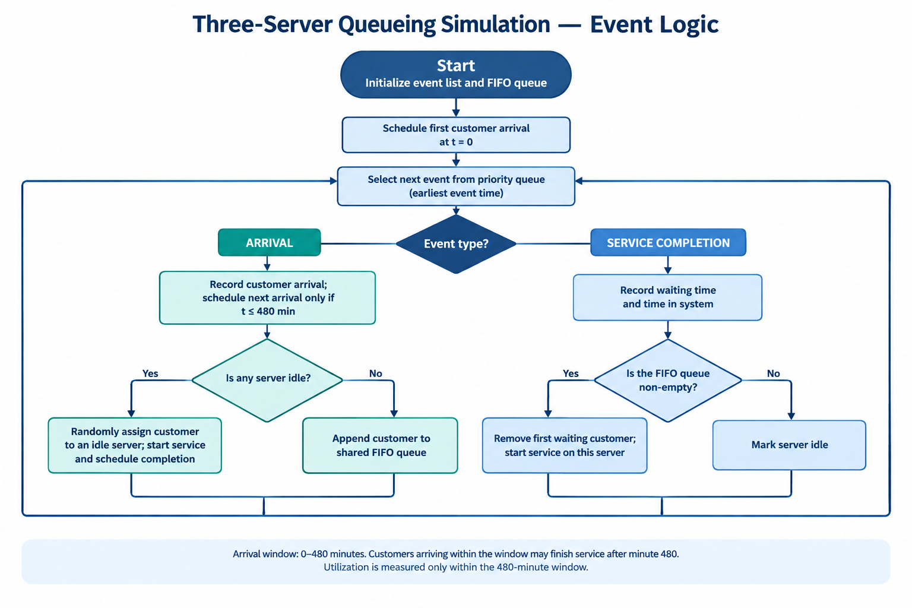
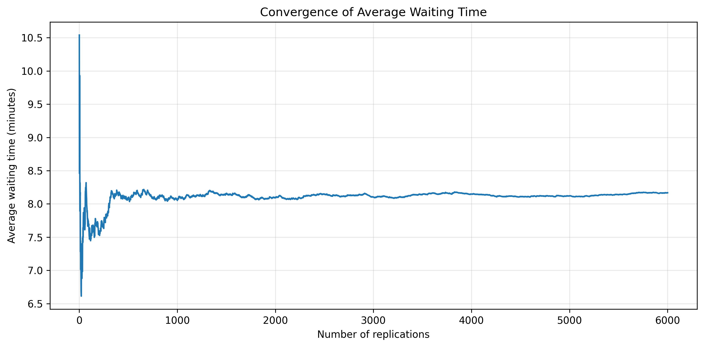
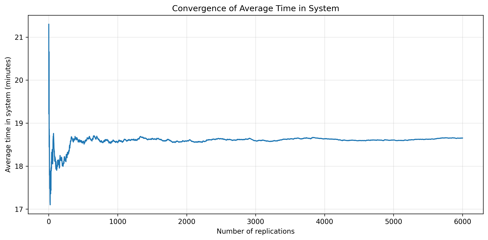
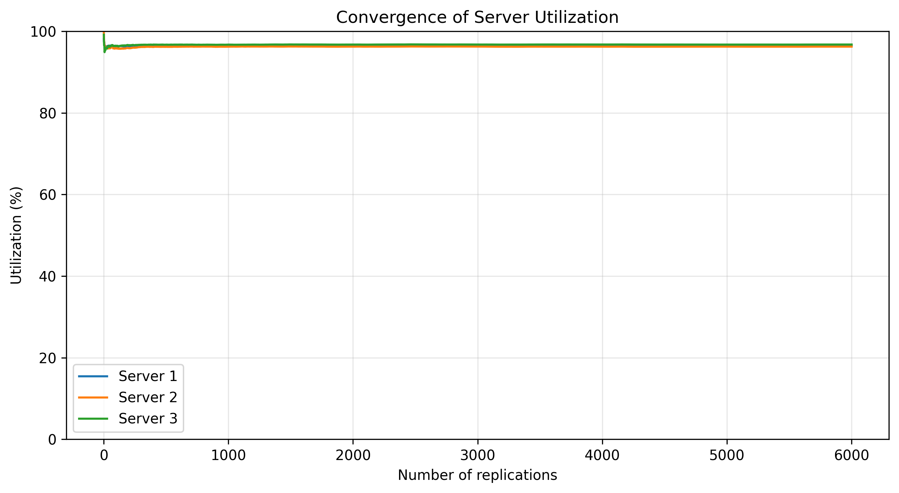
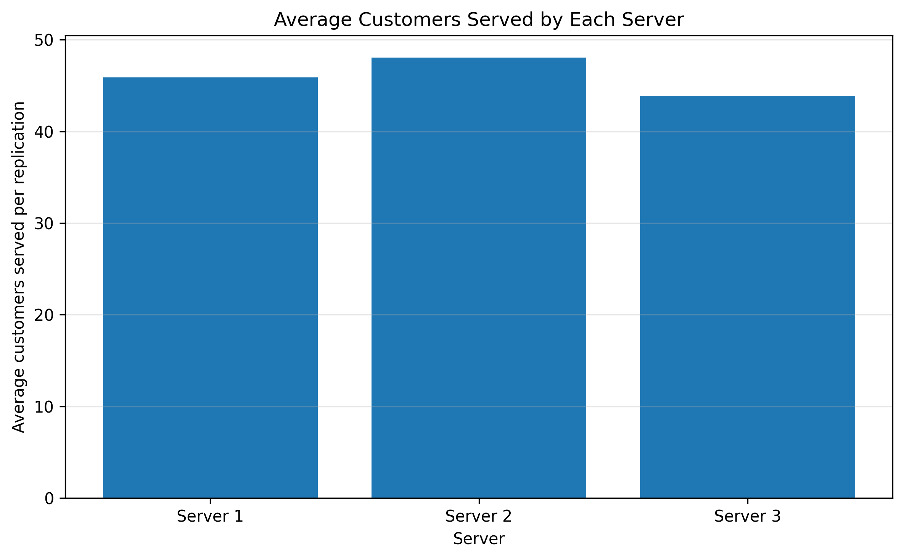

# Three-Server Queueing System Simulation

A Python discrete-event simulation of a shared queue served by three parallel servers. The project evaluates customer waiting, time in the system, queue length, workload by server, and server utilization over an eight-hour arrival window. It also compares estimates from 1,000, 2,000, 4,000, and 6,000 replications.

## Model at a glance

- **Simulation / arrival window:** 480 minutes (8 hours)
- **First arrival:** time 0
- **Interarrival times:** discrete uniform integers from 2 to 5 minutes, inclusive
- **Service time — Server 1:** discrete uniform integers from 6 to 15 minutes, inclusive
- **Service time — Server 2:** discrete uniform integers from 4 to 16 minutes, inclusive
- **Service time — Server 3:** discrete uniform integers from 8 to 14 minutes, inclusive
- **Queue discipline:** one shared first-in, first-out (FIFO) queue
- **Server assignment:** if multiple servers are idle, an arriving customer is assigned randomly among them
- **End of arrival window:** no new arrivals are scheduled after minute 480; customers already in the system can finish service after minute 480
- **Utilization measurement:** busy time is counted only within minutes 0–480
- **Random seed:** 2026
- **Replication counts:** 1,000; 2,000; 4,000; 6,000

The simulation advances from one scheduled event to the next using a priority queue. If a service completion and an arrival occur at the same time, the service completion is processed first.

## Event logic

The editable Visio diagrams are included in `docs/` , and they are currently labelled in Persian.




## Results

The table below reproduces the values in [`result/results_summary.csv`](./result/results_summary.csv). Values are means over the first *N* replications; the cases use nested prefixes of the same reproducible replication sequence.

| Performance measure | 1,000 replications | 2,000 replications | 4,000 replications | 6,000 replications |
|---|---:|---:|---:|---:|
| Average waiting time (minutes) | 8.0568 | 8.0982 | 8.1473 | 8.1675 |
| Average time in system (minutes) | 18.5486 | 18.5853 | 18.6360 | 18.6537 |
| Average total arrivals per replication | 137.6420 | 137.7360 | 137.7833 | 137.8477 |
| Average maximum queue length | 6.2730 | 6.2910 | 6.3398 | 6.3437 |
| Average customers served — Server 1 | 45.8020 | 45.8570 | 45.8758 | 45.8867 |
| Average customers served — Server 2 | 47.9490 | 48.0220 | 48.0183 | 48.0695 |
| Average customers served — Server 3 | 43.8910 | 43.8570 | 43.8893 | 43.8915 |
| Server 1 utilization (%) | 96.4371 | 96.4599 | 96.4920 | 96.5035 |
| Server 2 utilization (%) | 96.2181 | 96.2369 | 96.2237 | 96.2363 |
| Server 3 utilization (%) | 96.7240 | 96.7484 | 96.7546 | 96.7541 |

### What the results show

- In the 6,000-replication case, the estimated average wait is about **8.17 minutes** and the average time in the system is about **18.65 minutes**.
- All three servers have estimated utilization of approximately **96%** during the 480-minute observation window.
- The cumulative-average plots below make it possible to inspect how the estimates change as the number of replications increases.
- These results describe this model and its assumptions; they are not guarantees for a real-world system.

## Visual results

### Average waiting time

The cumulative average waiting-time plot shows how the estimated mean wait evolves across the replication sequence.



### Average time in the system

This plot tracks the cumulative estimate of the time from customer arrival until service completion.



### Server utilization

The three curves compare the cumulative utilization estimates for Server 1, Server 2, and Server 3.



### Customers served by server

The bar chart compares the average number of customers assigned to each server per replication.



## Repository contents

```text
three-server-queueing-simulation/
├── README.md
├── src/
│   └── simulation.py
├── result/
│   ├── convergence_data.csv
│   ├── customers_served_by_server.png
│   ├── replication_level_results.csv
│   ├── results_summary.csv
│   ├── server_utilization_convergence.png
│   ├── time_in_system_convergence.png
│   └── waiting_time_convergence.png
└── docs/
    ├── arrival_event_flowchart.vsdx
    ├── conceptual_model.vsdx
    ├── service_completion_flowchart.vsdx
    └── simulation_controller.vsdx
```

The files currently committed to `result/` are listed above. The repository does **not** contain a `results.zip` archive; the Python script creates that archive when it is run.

### Result files

| File | Contents |
|---|---|
| `result/results_summary.csv` | Comparison table for all four replication counts |
| `result/replication_level_results.csv` | Recorded performance measures for each individual replication |
| `result/convergence_data.csv` | Cumulative-average values used by the convergence plots |
| `result/waiting_time_convergence.png` | Cumulative average waiting time |
| `result/time_in_system_convergence.png` | Cumulative average time in the system |
| `result/server_utilization_convergence.png` | Cumulative utilization of the three servers |
| `result/customers_served_by_server.png` | Average customers served by each server |

### Model documentation

The `docs/` directory contains the original editable Visio files:

- [`conceptual_model.vsdx`](./docs/conceptual_model.vsdx)
- [`arrival_event_flowchart.vsdx`](./docs/arrival_event_flowchart.vsdx)
- [`service_completion_flowchart.vsdx`](./docs/service_completion_flowchart.vsdx)
- [`simulation_controller.vsdx`](./docs/simulation_controller.vsdx)

The Visio files are in Persian. This does not affect the Python simulation or the English README; the additional English flowchart image is intended to make the event logic immediately accessible to a broader audience.

## Run the simulation

Use Python 3 with the packages imported by the script: `pandas`, `matplotlib`, and `IPython`.

From the project directory (`three-server-queueing-simulation/`), run:

```bash
python -m pip install pandas matplotlib ipython
python src/simulation.py
```

The script writes the CSV files and four PNG charts into a directory named `results/` relative to the current working directory, and creates `results.zip` in the project directory. The committed outputs in this repository are in the separately named `result/` directory; running the script does not automatically replace those committed files.

The script uses `heapq` for event scheduling, `random` for reproducible random sampling, pandas for aggregation and CSV export, and Matplotlib for charts. It also uses `IPython.display` to display the comparison table in notebook environments such as Jupyter or Google Colab.

## Scope and limitations

The estimates depend on the specified arrival and service-time distributions, the shared FIFO queue, random assignment among idle servers, and the eight-hour arrival window. The current model does not include customer abandonment, service priorities, server breaks, or time-varying staffing.
